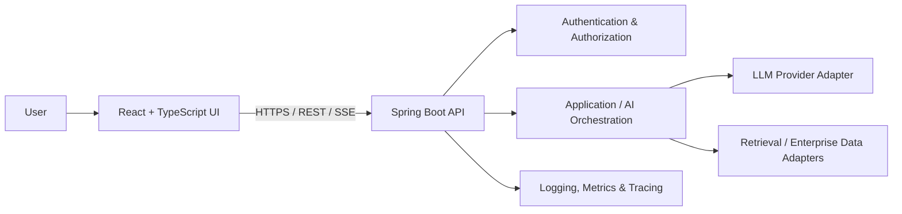

# GenAI Full-Stack Applications

A hands-on portfolio of full-stack Generative AI application patterns built around **React, TypeScript, Java 21, and Spring Boot**. The repository progresses from foundational AI chat experiences to enterprise-oriented workflows and banking use cases.

The projects are designed to demonstrate application architecture, API design, frontend integration, security considerations, and practical GenAI product patterns.

## Author

**Rama Boya**

- GitHub: https://github.com/ramu-fsd
- LinkedIn: https://www.linkedin.com/in/ramuboya

## Repository goals

- Build full-stack applications with a consistent React + Java backend structure.
- Explore streaming AI interactions, prompt management, document question answering, and knowledge portals.
- Demonstrate safe integration patterns for SQL assistants, customer support, meeting summaries, and financial insights.
- Document enterprise concerns such as authentication, authorization, privacy, auditability, observability, and governance.
- Grow from focused learning projects toward a banking-oriented reference platform.

## Technology stack

| Area | Technologies |
|---|---|
| Frontend | React, TypeScript, Vite |
| Backend | Java 21, Spring Boot |
| API | REST; Server-Sent Events (SSE) for streaming examples |
| AI integration concepts | LLM APIs, prompt engineering, RAG, tool calling, agentic workflows |
| Quality | JUnit, frontend testing practices, API validation |
| Delivery | Maven, npm, Docker-ready patterns, CI/CD documentation |

Specific projects may introduce additional libraries or infrastructure. Check each project README for its actual dependencies and implementation status.

## Project roadmap

| # | Project | Focus |
|---:|---|---|
| 01 | `01-ai-chat-assistant` | Full-stack chat UI and backend API |
| 02 | `02-streaming-ai-chat` | Streaming responses with SSE |
| 03 | `03-ai-prompt-playground` | Prompt experimentation and comparison |
| 04 | `04-ai-content-generator` | Structured content generation |
| 05 | `05-document-qa-assistant` | Document question-answering workflow |
| 06 | `06-enterprise-knowledge-portal` | Enterprise knowledge access patterns |
| 07 | `07-ai-sql-assistant` | Natural-language-to-SQL drafting with safety controls |
| 08 | `08-ai-customer-support-portal` | Support assistant experience and guardrails |
| 09 | `09-ai-meeting-assistant` | Meeting text summarization starter |
| 10 | `10-ai-financial-insights-platform` | Financial insight narrative demo |
| 11 | `11-agentic-workflow-platform` | Agent workflow planning patterns |
| 12 | `12-enterprise-banking-ai-platform` | Enterprise banking reference application |

## High-level architecture



This is a conceptual architecture. Individual projects implement only the components described in their own documentation.

## Repository structure

```text
genai-fullstack-applications/
├── 01-ai-chat-assistant/
├── 02-streaming-ai-chat/
├── 03-ai-prompt-playground/
├── 04-ai-content-generator/
├── 05-document-qa-assistant/
├── 06-enterprise-knowledge-portal/
├── 07-ai-sql-assistant/
├── 08-ai-customer-support-portal/
├── 09-ai-meeting-assistant/
├── 10-ai-financial-insights-platform/
├── 11-agentic-workflow-platform/
├── 12-enterprise-banking-ai-platform/
├── docs/
├── .editorconfig
├── .gitattributes
├── .gitignore
├── CODE_OF_CONDUCT.md
├── CONTRIBUTING.md
├── LICENSE
├── README.md
└── SECURITY.md
```

## Getting started

1. Clone the repository.
2. Choose a project folder and read its README before running it.
3. Confirm the Java and Node.js versions required by that project.
4. Start the backend using the Maven instructions in its README.
5. Start the frontend using the npm instructions in its README.
6. Configure provider credentials only when a project explicitly supports a real provider integration. Keep secrets in environment variables or a secret manager; never commit them.

Commands vary by project. Use the project-level README as the source of truth rather than assuming every project has identical scripts.

## Important implementation status

These projects are **learning and portfolio starters**, not a claim of production-ready AI systems. The current starter implementations use deterministic demo responses in their backend APIs. They do not include configured LLM provider credentials or live provider integrations by default.

In particular:
- The SQL assistant demonstrates safe SQL-drafting concepts; it does not execute generated SQL.
- The meeting assistant is a text-summary starter; it does not perform audio transcription.
- The agentic workflow project documents/plans workflows; it does not provide unrestricted tool execution.
- The banking platform is a reference starter, not a deployable production banking solution.
- RAG and knowledge projects are scaffolds and require real ingestion, retrieval, access-control, and evaluation integrations.

Before using any project with real users or sensitive data, implement and validate authentication, authorization, tenant isolation, input/output controls, privacy, audit logging, rate limits, cost controls, observability, testing, and operational safeguards.

## Learning path

A suggested progression:

1. Start with projects 01–04 to understand full-stack interaction patterns.
2. Continue with projects 05–08 for enterprise knowledge and domain workflows.
3. Explore projects 09–11 for summarization, analytics narratives, and agentic design.
4. Finish with project 12 and document the architecture, NFRs, threat model, and operational model.

## License

This repository is licensed under the MIT License. See [LICENSE](LICENSE).
